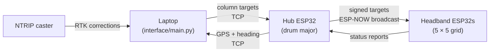

# HaptiBand

**A haptic headband system that helps visually impaired marching band members stay in formation.**

HaptiBand is a prototype in which each band member wears a headband with four vibration motors. A network of ESP32 microcontrollers, talking over ESP-NOW, compares each member's GPS position and heading against where they should be in the formation, then buzzes to guide them back into line.

Supported by: Cal Poly College of Engineering, EMPOWER, Pacific West Music of the Blind

## How it works



1. The **hub**, carried by the drum major at the front of the formation, hosts a Wi-Fi access point and reports its GPS position and heading to the laptop.
2. The **laptop** works out a target position for each of the five columns, which are spaced 3 ft apart perpendicular to the direction of travel, and sends those targets back to the hub. It also relays RTK correction data from an NTRIP caster for centimeter-level GPS.
3. The hub broadcasts each target over **ESP-NOW**, signed with HMAC-SHA256 and protected against replay by sequence numbers.
4. Each **headband** keeps only the message for its own row and column, compares the target with its own position and heading, and vibrates to correct it. A ≤5° heading error gets no feedback, 6–15° gets a single pulse, and more than 15° gets a double pulse.

## Repository layout

```
├── firmware/                 Current ESP32 firmware (Arduino IDE sketches)
│   ├── hub/                  Drum major hub: Wi-Fi AP, TCP ↔ ESP-NOW bridge, GPS
│   └── headband/             Band member headband: motors, GPS, signature check
├── interface/                Laptop-side Python (standard library only)
│   ├── main.py               Main dashboard: formation grid, manual + GPS control, RTK relay
│   ├── gps_cli.py            Command-line GPS guidance mode
│   ├── rtk.py                NTRIP client for RTK corrections
│   ├── motors.py             Standalone motor test GUI
│   └── language.py           Haptic pattern designer
├── testing/                  Bench tests for individual components
│   ├── esp_pins/             Detects WROOM vs. WROVER (PSRAM / GPIO16-17 check)
│   ├── gps_serial/           Raw GPS UART output test
│   ├── imu/                  ICM-20948 sensor fusion (Mahony and Madgwick filters)
│   ├── ble_scanner.py        BLE device scanner (needs `bleak`)
│   └── gps_split.py          Column-offset math prototype
└── archive/                  Earlier versions of the system, kept for reference
    ├── manual_control/       First version: keyboard-driven motor control only
    └── gps_v1/               First GPS guidance prototype
```

## Getting started

### Requirements

- **Firmware:** [Arduino IDE](https://www.arduino.cc/en/software) with the ESP32 board package. The IMU tests also need the Adafruit ICM20X and Adafruit AHRS libraries.
- **Laptop:** Python 3.12 or later, with no third-party packages (see `requirements.txt` for tkinter notes).

### 1. Flash the firmware

1. Open `firmware/hub/hub.ino` and flash it to the hub ESP32 first, since the hub sets up the Wi-Fi access point.
2. In `firmware/headband/headband.ino`, set `ROW_NUM` and `COL_NUM` for the headband you are flashing, then flash it. Repeat for each headband.

### 2. Run the dashboard

1. Connect the laptop to the `PWMB_Hub` Wi-Fi network (the password is set in `firmware/hub/hub.ino`).
2. Start the dashboard:

   ```bash
   python interface/main.py
   ```

   Or use the command-line version: `python interface/gps_cli.py`

3. Watch the serial monitor on the ESP32s for debug output.

To test RTK corrections on their own: `python interface/rtk.py --list`

## Hardware

| Motor position | GPIO |
|----------------|------|
| Left temple    | 5    |
| Forehead       | 18   |
| Right temple   | 19   |
| Back of head   | 23   |

The GPS module connects to UART2 on GPIO 21 (RX) and GPIO 22 (TX) on both the hub and the headbands.

> **Before a real deployment:** change the hub Wi-Fi password and the shared `HMAC_KEY` in both firmware files, then reflash every device.

## Team

- Emma Merriman
- Clara Swanson
- Hudson Schmidt
- Chandni Sharma
- Phoebe Eplett
- Amanda Le
- Cody Cascalla
